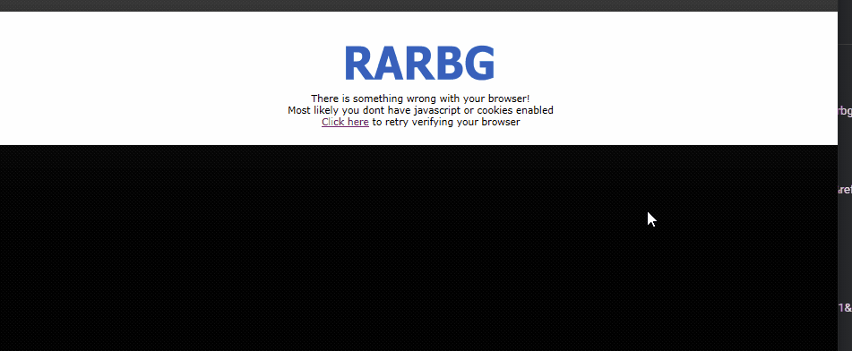
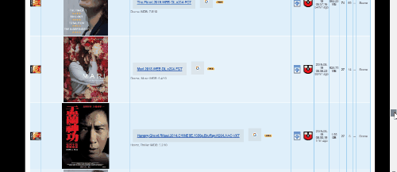
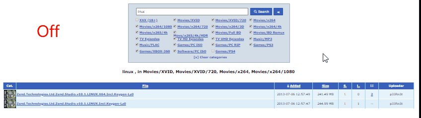
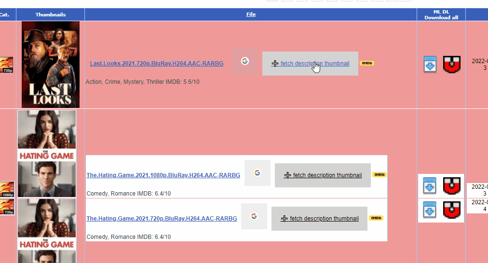
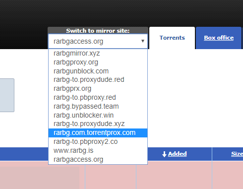
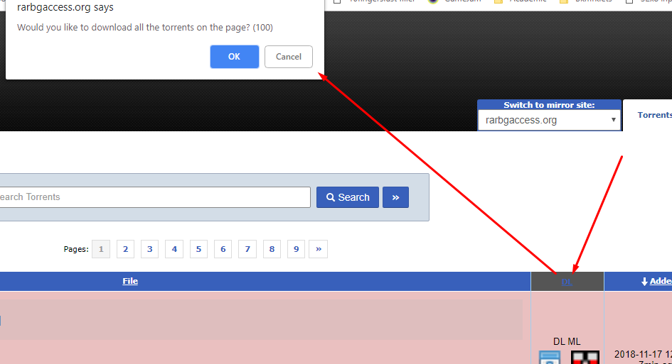

<div align="center">
  

  <h1>RARBG Enhancer</h1>

  <p><strong>A userscript fork that adds CAPTCHA handling, infinite scroll, thumbnails, mirror switching, magnet shortcuts, and UI controls for RARBG-style mirror pages.</strong></p>

  <p>
    <a href="./LICENSE"></a>
    
    
    
  </p>

  <p>
    <a href="#install">Install</a> &middot;
    <a href="#features">Features</a> &middot;
    <a href="#screenshots">Screenshots</a> &middot;
    <a href="#keyboard-shortcuts">Keyboard shortcuts</a> &middot;
    <a href="#license">License</a>
  </p>
</div>

[](LICENSE)
[](rarbg-enhancer.user.js)
[](https://github.com/tyhallcsu/rarbg-enhancer/raw/main/rarbg-enhancer.user.js)
[](https://www.tampermonkey.net/)
[](https://violentmonkey.github.io/)


Tampermonkey userscript for RARBG mirrors — seeder-based row highlighting, filtering, and a floating settings modal.


> A merged fork of [RARBG Enhancer 6](https://github.com/FarisHijazi/Rarbg-Enhancer-UserScript)
> by Faris Hijazi and [RARBG Torrents – Dynamic Column Highlighting v5](https://greasyfork.org/scripts/493324)
> by sharmanhall, with a Shadow-DOM floating settings modal added on top.


## Features

### New in this fork (6.2.x)
- **Dynamic seeder-column detection + threshold-based row coloring** — finds the seeder column by scanning for `.lista2t a[href*="seeders"]`, so it survives column reordering across mirrors. Defaults: highlight at `≥100` seeders, color `#c0edc8`. Both configurable.
- **Hide rows below threshold** — optional filter to declutter low-seeder rows. Composes cleanly with the enhancer's existing row-hiding logic.
- **`MutationObserver`-driven** — re-highlights on every row mutation (including infinite-scroll-appended rows) instead of polling every second.

### Floating settings modal

The headline UX of this fork (see hero image above). Click the bottom-right green **⚙** button on any RARBG mirror page and a card-style settings panel opens.

- **Live counter pills** — `200 rows · 12 highlighted · 188 hidden` updates on every highlight pass, so the threshold's effect is visible without scrolling the table.
- **Settings apply live** — toggles in the **Seeder Highlighting** section (enable, threshold, color, hide-below, auto-scroll-when-filtered-short) take effect immediately. No reload. Persists via `GM_setValue` under the `rbhl_*` namespace.
- **Enhancer shortcuts** — the four most-toggled legacy options (large thumbnails, infinite scrolling, hide recommended, hover sound) are surfaced in the same panel. Marked "(reload required)" — they read from `GM_config` storage which the enhancer reads at boot.
- **Keyboard** — `Esc` closes, `Ctrl`+`/` toggles. Click the dark scrim or the × in the header to dismiss.
- **Shadow-DOM isolated** — the panel attaches an open shadow root so RARBG's aggressive page CSS (and any user-installed Stylus rules) can't leak in or break the layout.
- **Escape hatch** — `Full settings…` in the footer opens the legacy `GM_config` panel for everything not surfaced in the modal (mirrors list, image search engine, category blocks, etc.).

### Auto-solve threat-defence CAPTCHA


### Infinite scrolling — auto-append the next page


### Adds thumbnails to torrent rows


### Image search links — fetch description thumbnails + extra Google Images


### Magnet + .torrent download shortcuts on every row
### Mirror dropdown to swap between RARBG mirrors


### "Download all torrents" button


### Disables redirect-overlay ads where the entire page is a hidden link

## Install

### Prerequisites

A userscript manager. Pick one:

<table>
<tr>
<td align="center"><a href="https://www.tampermonkey.net/"></a></td>
<td><b>Tampermonkey</b><br>Chrome, Edge, Firefox, Safari, Opera<br><a href="https://www.tampermonkey.net/">tampermonkey.net</a></td>
</tr>
<tr>
<td align="center">🐒</td>
<td><b>Violentmonkey</b><br>Chrome, Edge, Firefox<br><a href="https://violentmonkey.github.io/">violentmonkey.github.io</a></td>
</tr>
</table>

### One-click install

<a href="https://github.com/tyhallcsu/rarbg-enhancer/raw/main/rarbg-enhancer.user.js"></a>

👉 **[Install rarbg-enhancer.user.js](https://github.com/tyhallcsu/rarbg-enhancer/raw/main/rarbg-enhancer.user.js)**

Your userscript manager will detect the file and prompt to install. Review the metadata block + `@require`d libraries and click **Install**.

> **Auto-update**: the `@updateURL` / `@downloadURL` headers point at this repo's `main` branch raw URL. Tampermonkey will check for updates on its check interval (default: once a day) and apply them silently.

### Manual install

1. Download [`rarbg-enhancer.user.js`](rarbg-enhancer.user.js).
2. **Tampermonkey** → **Dashboard → Utilities → Import from file**, or drag the file onto the dashboard.

See [`docs/INSTALL.md`](docs/INSTALL.md) for screenshots.

## Configuration

Click the green **⚙** button in the bottom-right of any RARBG mirror page to open the floating settings modal. See [`docs/SETTINGS.md`](docs/SETTINGS.md) for the full reference.

| Setting | Default | What it does |
|---|---|---|
| Enable highlighting | `on` | Master switch. Off → no row coloring, no hiding. |
| Seeder threshold | `100` | Rows with seeders **≥** this value are highlighted. |
| Highlight color | `#c0edc8` | Background color applied to highlighted rows. |
| Hide rows below threshold | `off` | When on, rows below threshold are hidden. |
| Auto-scroll when filtered short | `on` | Force the next page to load if filtering shrinks the page below the viewport. Capped at 8 consecutive auto-loads. |
| Large thumbnails | (enhancer) | Toggles enhancer's large-thumbnail mode. |
| Infinite scrolling | (enhancer) | Toggles enhancer's infinite scroll. |
| Hide recommended torrents | (enhancer) | Removes the "recommended" sidebar block. |
| Thumbnail hover sound | (enhancer) | Plays a click sound on thumbnail hover. |

Highlight settings persist across reloads under `GM_setValue` keys `rbhl_enabled`, `rbhl_threshold`, `rbhl_color`, `rbhl_hideBelow`, `rbhl_autoScrollAssist`. Enhancer toggles persist via the legacy `GM_config` storage. Highlight settings apply live; enhancer toggles need a reload.

You can also open the legacy full settings panel by clicking **"Open full settings…"** in the modal, by pressing `Ctrl+/`, or via the green **⚙ Script Settings** tab the script injects into the page navbar.

## Keyboard shortcuts

Inherited from the upstream enhancer:

- `/` — focus the search bar
- `` ` `` — toggle thumbnail sizes (small ↔ large; useful on slow connections)
- `Ctrl+S` — save an HTML file containing the page + torrent/magnet links
- `d` (on a torrent page) — download the torrent + sample images + HTML page + summary
- `← / →` — navigate between paginated pages
- `Ctrl+/` — open the legacy GM_config settings panel
- `=` / `-` — increment/decrement thumbnail image size

## Supported mirrors

The userscript runs on the following hosts (and any URL matching `https://*rarbg.*` or the regex `https?://.{0,8}rarbg.*\\..*`):

```
proxyrarbg.org      rarbg.com           rarbg.to            rarbg2018.org
rarbg2019.org       rarbg2020.org       rarbg2021.org       rarbgaccess.org
rarbgaccessed.org   rarbgcdn.org        rarbgcore.org       rarbgdata.org
rarbgenter.org      rarbgget.org        rarbggo.org         rarbgindex.org
rarbgmirror.com     rarbgmirror.org     rarbgmirrored.org   rarbgp2p.org
rarbgproxied.org    rarbgproxies.org    rarbgproxy.com      rarbgproxy.org
rarbgprx.org        rarbgto.org         rarbgtor.org        rarbgtorrents.org
rarbgunblock.com    rarbgunblock.org    rarbgunblocked.org  rarbgway.org
rarbgweb.org        unblockedrarbg.org  www.proxyrarbg.to   www.rarbg.is
www.rarbggo.to      www.rarbgo.to       www.rarbgproxy.to   www2.rarbggo.to
```

> ⚠ The official `rarbg.to` is down, but this script continues to work on the
> [active mirrors](https://rargb.to/) listed above.

## Development

### File layout

```
.
├── rarbg-enhancer.user.js          # the userscript (single-file deliverable)
├── scripts/
│   └── validate-header.js          # CI: parses @-fields, asserts JS validity
├── docs/
│   ├── INSTALL.md                  # detailed install walkthrough
│   ├── SETTINGS.md                 # full settings reference
│   ├── CODE-WALKTHROUGH.md         # adapted from upstream docs.md
│   ├── icons/                      # README assets
│   └── screenshots/                # demo gifs / pngs (from upstream)
├── .github/
│   ├── ISSUE_TEMPLATE/             # bug + feature forms
│   ├── PULL_REQUEST_TEMPLATE.md
│   ├── workflows/ci.yml            # lint + validate on push/PR
│   └── dependabot.yml
├── CHANGELOG.md
├── CONTRIBUTING.md
├── HANDOFF.md
└── package.json                    # devDeps only (eslint, prettier)
```

### Local testing

The fastest loop:

1. Open Tampermonkey → **Dashboard**.
2. Find **RARBG Enhancer + Highlighter (Merged)** → click the script name → built-in editor opens.
3. Paste your local edits in. Save.
4. Hard-reload a RARBG mirror page (`Cmd-Shift-R` / `Ctrl-Shift-R`).

Some browsers require enabling **Developer mode** for Tampermonkey before file-based loading works — see [Tampermonkey FAQ](https://www.tampermonkey.net/faq.php).

### Scripts

```bash
npm install            # install eslint + prettier
npm run lint           # ESLint over scripts/
npm run format         # Prettier write
npm run validate       # parse @-fields + JS syntax check
npm run ci             # what GitHub Actions runs
```

## Credits

- **Dynamic seeder-column highlighting (v5)** — [sharmanhall](https://greasyfork.org/scripts/493324)
- **RARBG Enhancer 6 (base)** — [Faris Hijazi](https://github.com/FarisHijazi/Rarbg-Enhancer-UserScript) (original) + tyhallcsu (this fork)
- **Helper code + magnet-link generation** — [darkred](https://greasyfork.org/en/users/2160-darkred)
- **Original "add magnet link" idea** — [Cisco](https://greasyfork.org/en/users/16455-cisco)
- **Screenshots and icons** under `docs/screenshots/` and `docs/icons/` are from the upstream [Rarbg-Enhancer-UserScript](https://github.com/FarisHijazi/Rarbg-Enhancer-UserScript) repository, used under MIT.

## License

[MIT](LICENSE) © 2026 sharmanhall, with attribution to prior authors above. This script is for educational purposes — it does not promote piracy, it's a UI-improvement tool for an existing website.
