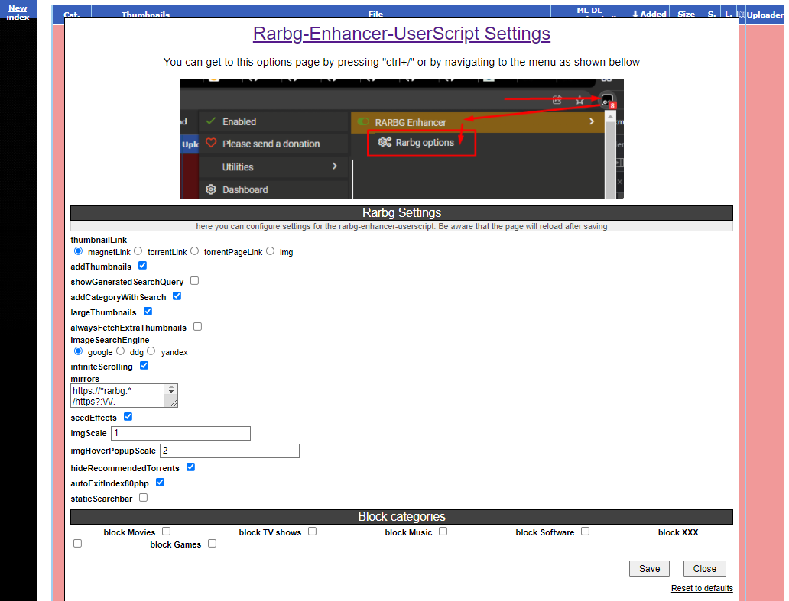
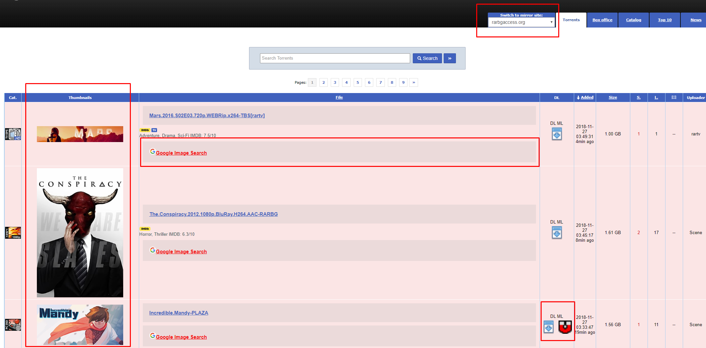
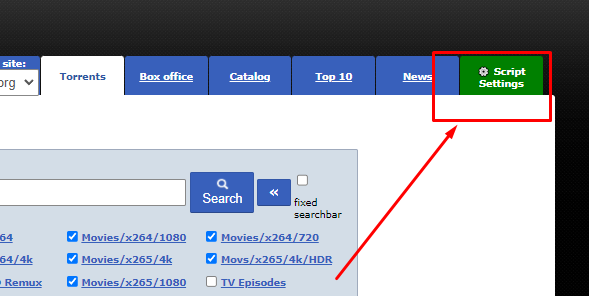

# Install

A walkthrough for getting `rarbg-enhancer` running in your browser. If you've
installed userscripts before, the [README's one-click install](../README.md#one-click-install)
is faster.

## 1. Pick a userscript manager

Both options are free, open source, and work on every major browser.

<table>
<tr>
<td align="center"></td>
<td><b>Tampermonkey</b> Chrome, Edge, Firefox, Safari, Opera <a href="https://www.tampermonkey.net/">tampermonkey.net</a></td>
</tr>
<tr>
<td align="center">🐒</td>
<td><b>Violentmonkey</b> Chrome, Edge, Firefox <a href="https://violentmonkey.github.io/">violentmonkey.github.io</a></td>
</tr>
</table>

Tampermonkey is the more common pick and what this script is primarily tested against, but Violentmonkey works.

> **Chrome / Edge users**: enable **Developer mode** in `chrome://extensions` (or `edge://extensions`) before the manager will let arbitrary userscripts run. This is a Chrome/Edge requirement, not ours.

## 2. Install the script

### One-click (recommended)

Click the install link:

👉 **[Install rarbg-enhancer.user.js](https://github.com/tyhallcsu/rarbg-enhancer/raw/main/rarbg-enhancer.user.js)**

Your manager will detect the userscript and show its install screen, listing the metadata, `@require`d libraries, and `@grant`s. Review and click **Install**.

> **Auto-update**: the userscript's `@updateURL` and `@downloadURL` point at `https://github.com/tyhallcsu/rarbg-enhancer/raw/main/rarbg-enhancer.user.js`. Tampermonkey checks for updates on its check interval (default: once a day) and applies them silently. To force a check now: **Dashboard → Installed Userscripts → Check for Updates**.

### From a downloaded copy

1. Download [`rarbg-enhancer.user.js`](../rarbg-enhancer.user.js) (or `git clone` the repo).
2. **Tampermonkey** → **Dashboard** → **Utilities** → **Import from file** → pick the `.user.js` file. Or simply drag the file onto the Tampermonkey dashboard tab.
3. **Violentmonkey** → **Dashboard** → **+** → **Install from URL or file**.

The legacy enhancer settings panel (opened via `Ctrl+/` or the **⚙ Script Settings** tab the script injects) looks like this:

> The new floating Shadow-DOM modal in the bottom-right is the recommended way to drive the highlighter. The legacy panel covers everything else and was given a matching dark redesign in v6.2.6.

## 3. Verify it's running

1. Visit any RARBG mirror (see the [supported list](../README.md#supported-mirrors)).
2. You should see:
   - A green **⚙** floating button bottom-right.
   - A green **⚙ Script Settings** tab in the page navbar.
   - Rows with seeders ≥ 100 highlighted in pale green.
   - Inline thumbnails on torrent rows (if `largeThumbnails` is enabled).

The little ⚙ icon in the page navbar — that's the legacy settings tab the script injects:

If nothing happens:
- Check Tampermonkey's icon — it should show "1" (or higher) for the active
  tab. If it shows "0", the `@include` block didn't match this URL. Open an
  issue with the URL.
- Open DevTools console (`F12` → Console). Search for `Script:` — the script
  logs its meta block on every page it runs on.

## 4. Updates

The userscript header points `@updateURL` at this repo's `main` branch raw URL.
Tampermonkey will check for updates on its own schedule (default: once a day).

To check now: **Tampermonkey Dashboard** → **Installed Userscripts** →
**Last Updated column** → click the time → **Check for Updates**.

## Troubleshooting

| Symptom | Likely cause |
|---|---|
| Floating ⚙ button missing | Mirror not in `@include` list. File an issue. |
| Highlight not applying | Threshold too high, or seeder column not detected. Open the modal → confirm threshold; reload page; check console for `[RBHighlighter]` warnings. |
| "Open full settings…" reloads page on save | Expected. The legacy `GM_config` panel always reloads on save. The modal's own controls (threshold, color, hide-below, enable) apply live without reload. |
| Script doesn't update | Manually re-install via the one-click link above. Confirm `@updateURL` matches your fork. |
